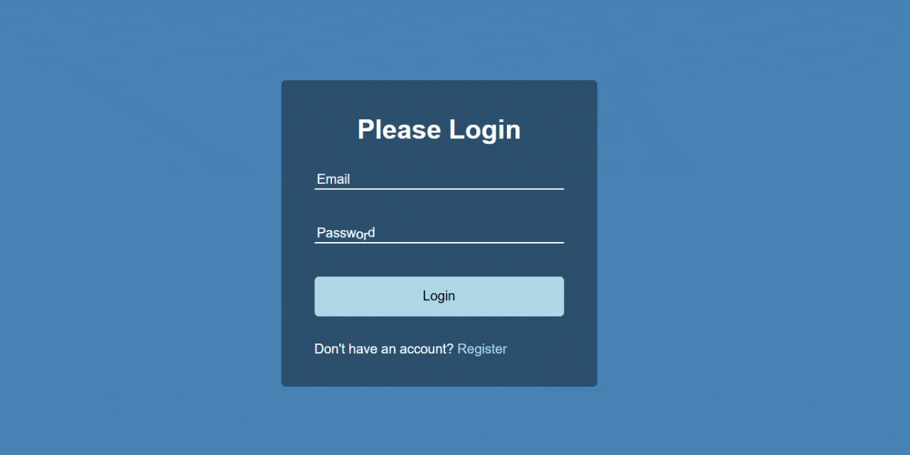

# Form Input Wave Animation

A clean, modern, and interactive login form featuring animated floating label text using HTML, CSS, and vanilla JavaScript.



## 🔗 Live Demo

- [View Live Demo](https://dasjp.github.io/Form-Wave-Animation/)

## :rocket: How It Works

- **DOM Querying:** The script queries all label elements inside the `.form-control` wrapper (`.form-control label`).
- **Character Splitting & Wrapping:** For each label, the inner text (e.g., "Email" or "Password") is extracted via `.innerText`, split into individual characters using `.split("")`, and mapped into individual `<span>` elements.
- **Staggered Transition Delay:** Each generated `<span>` receives an inline `transition-delay` calculated dynamically by multiplying its index (`idx`) by `50ms` (`idx * 50ms`). This produces a cascading wave effect when the input fields are focused.

## :hammer_and_wrench: Built With

- **HTML5** - Form structure containing Email and Password input fields and a submit button.
- **CSS3** - Card layout, absolute positioning, custom focus styling, and transition properties.
- **Vanilla JavaScript (ES6)** - DOM manipulation, array methods (`map`, `join`), and template literals.

## :desktop_computer: Core JavaScript Code

```javascript
const labels = document.querySelectorAll(".form-control label");

labels.forEach((label) => {
  label.innerHTML = label.innerText
    .split("")
    .map(
      (letter, idx) =>
        `<span style="transition-delay:${idx * 50}ms">${letter}</span>`,
    )
    .join("");
});
```

## :open_file_folder: Project Structure

```text
form-input-wave/
│
├── index.html       # Login form HTML layout structure
├── style.css        # Styles, layout, and wave transition effects
├── script.js        # Logic for splitting labels into animated span characters
└── README.md        # Project documentation

```

## :bust_in_silhouette: Author

- Jaya Prakash Das
- [GitHub Profile](https://github.com/DasJP)
- [LinkedIn Profile](https://www.linkedin.com/in/jaya-prakash-das)
